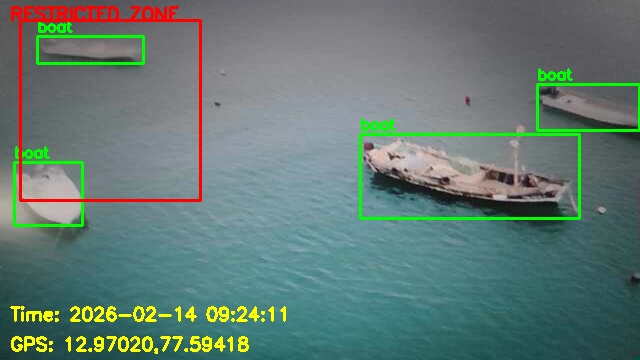

# AquaSentinel AI — Maritime Threat Detection System

A computer-vision prototype for maritime surveillance, built around a drone-camera concept. It uses YOLOv8 and OpenCV to detect boats and people from a live camera feed, raises an alert when a boat enters a restricted zone, and saves evidence images. A Streamlit dashboard shows the live feed and an evidence gallery.




## Features

- Live camera input (phone IP Webcam stream)
- YOLOv8 detection of boats and people
- Restricted-zone check using a configurable rectangle
- Alert cooldown so one boat does not trigger repeated alerts
- Automatic evidence-image capture into `evidence/`
- Streamlit dashboard with live feed and evidence gallery
- Camera connection test script

## How it works

1. A camera frame is read from a phone running an IP Webcam app.
2. YOLOv8n detects objects in the frame.
3. If a boat's center point falls inside the restricted-zone rectangle, an alert is printed with a simulated GPS position.
4. The annotated frame is saved to `evidence/`.

## Project files

| File | Purpose |
| --- | --- |
| `dashboard.py` | Streamlit dashboard and evidence gallery |
| `live_illegal_fishing_detector.py` | Boat and restricted-zone detection with alerts and evidence capture |
| `live_detection.py` | Lightweight live detection preview |
| `test_cam.py` | Camera stream connection test |
| `evidence/samples/` | Sample detection images |
| `requirements.txt` | Python dependencies |

## Setup

1. Clone the repo:
```bash
   git clone https://github.com/tharun-rhaj/AquaSentinel-AI.git
   cd AquaSentinel-AI
```
2. Create a virtual environment.

   Windows:
```powershell
   python -m venv .venv
   .venv\Scripts\activate
```
   Linux/macOS:
```bash
   python3 -m venv .venv
   source .venv/bin/activate
```
3. Install dependencies:
```bash
   pip install -r requirements.txt
```
4. Install an IP Webcam app on your phone, start the server, and note the stream URL (for example `http://<phone-ip>:8080/video`). Your phone and computer must be on the same Wi-Fi network.
5. Open the script you want to run and replace `enter your camera url` with your stream URL. Never upload your real camera URL back to GitHub.
6. Run:
```bash
   python test_cam.py
   python live_illegal_fishing_detector.py
   streamlit run dashboard.py
```
   Press `q` or `Esc` to close the OpenCV window (the key is shown in each script). Press `Ctrl+C` to stop Streamlit.

The YOLOv8 weights (`yolov8n.pt`) download automatically on first run, so internet access is needed once.

## Limitations

- This is a prototype, not a validated safety system.
- GPS coordinates are simulated, not read from a GPS receiver.
- Person detection only finds a person in the frame. It does not detect drowning or whether the person is in water.
- The restricted zone is a pixel rectangle on the image, not a real geographic boundary.
- Accuracy depends on camera angle, lighting, and image quality.

## Tech stack

Python · Ultralytics YOLOv8 · OpenCV · Streamlit

## License

MIT License. See [LICENSE](LICENSE).
